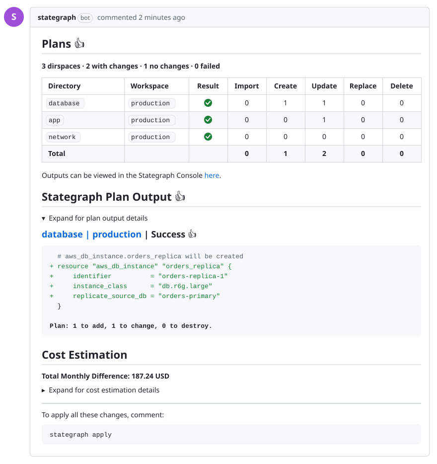
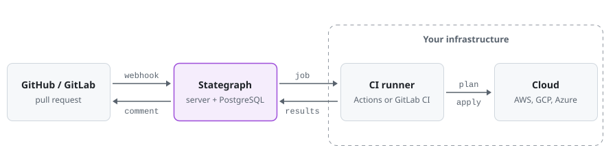

<p align="center">
  <a href="https://stategraph.com">
    <picture>
      <source media="(prefers-color-scheme: dark)" srcset="https://raw.githubusercontent.com/stategraph/brand-artifacts/c6f63a114680a786452b2f28af87637c66c3ec10/logos/wordmark/stategraph_logo_wordmark_white.svg">
      
    </picture>
  </a>
</p>

<p align="center">
  <b>Open-source pull request automation for Terraform and OpenTofu</b>
</p>

<p align="center">
  <a href="https://stategraph.com/docs/get-started/quickstart/self-hosted">Quickstart</a> ·
  <a href="https://stategraph.com/docs/orchestration">Docs</a> ·
  <a href="https://app.stategraph.cloud">Stategraph Cloud</a> ·
  <a href="https://stategraph.com/slack">Slack</a>
</p>

<p align="center">
  <a href="https://github.com/stategraph/stategraph/releases"></a>
  <a href="LICENSE"></a>
  <a href="https://ocaml.org"></a>
</p>

<p align="center">
  <picture>
    <source media="(prefers-color-scheme: dark)" srcset="assets/pr-comment-dark.svg">
    
  </picture>
</p>


Stategraph listens for pull request events from GitHub or GitLab, runs `terraform plan` for each changed directory, and comments back with the output. Changes apply from a `stategraph apply` comment or on merge. Plans and applies run as jobs in your own GitHub Actions or GitLab CI, with your own cloud credentials.

## Quickstart

```bash
git clone --depth 1 https://github.com/stategraph/stategraph.git
cd stategraph/docker/stategraph
docker compose up -d
```

Open <http://localhost:8080> and follow the [self-hosted guide](https://stategraph.com/docs/get-started/quickstart/self-hosted) to connect GitHub or GitLab.

To use the hosted version instead, sign up for [Stategraph Cloud](https://app.stategraph.cloud).

Moving from another Terraform automation tool is covered in the [migration guides](https://stategraph.com/docs/orchestration/migration).

## Configuration

Without a config file, Stategraph plans every directory whose Terraform files change in a pull request. To choose the engine, apply on merge, or schedule drift detection, add a `.stategraph/config.yml` file at the root of the repository:

```yaml
engine:
  name: tofu            # terraform, tofu, stategraph, terragrunt, cdktf, pulumi, or custom
when_modified:
  autoapply: true       # apply on merge
drift:
  enabled: true
  schedules:
    nightly:
      tag_query: ""     # all directories
      schedule: daily
```

See the [configuration reference](https://stategraph.com/docs/orchestration/configuration) for all options.

## Features

- Parallel plans across every directory and workspace a pull request touches
- Directory locks that prevent conflicting applies across pull requests
- Policy checks with OPA and Conftest
- Security scans with Checkov
- Cost estimates in the pull request
- Applies in dependency order across directories
- Scheduled drift detection
- Support for monorepos and multi-repo setups
- Terraform, OpenTofu, Terragrunt, CDKTF, and Pulumi on GitHub and GitLab

## How it works

<p align="center">
  <picture>
    <source media="(prefers-color-scheme: dark)" srcset="assets/how-it-works-dark.svg">
    
  </picture>
</p>

The Stategraph server works out which directories a pull request changes and starts plan and apply jobs on your CI runners. Terraform runs on those runners with your cloud credentials, and the results go back to the server for the pull request comment.

## State as a graph

Infrastructure as a Database replaces the state file with a dependency graph in PostgreSQL. Plans read only the resources a change touches, changes that do not overlap apply concurrently, and SQL queries run across every state:

```console
$ stategraph query "SELECT type, count(*) FROM resources GROUP BY type"
 aws_instance         20
 aws_security_group   15
 aws_subnet            6
```

<div align="center">
  <picture>
    <source media="(prefers-color-scheme: dark)" srcset="assets/subgraph-execution-dark.svg">
    
  </picture>
</div>

Infrastructure as a Database is commercial and not part of this repository. It runs on [Stategraph Cloud](https://app.stategraph.cloud) or self-hosted with a license key, and Orchestration can use it for pull request plans and applies. See the [documentation](https://stategraph.com/docs/infrastructure-as-a-database).

## Editions

Everything above except Infrastructure as a Database is open source under MPL-2.0. Orchestration Pro adds RBAC, CODEOWNERS enforcement, approval gates, and centralized configuration. See [Editions](https://stategraph.com/docs/get-started/editions).

## Community

- Questions: [Slack](https://stategraph.com/slack)
- Bugs and feature requests: [GitHub Issues](https://github.com/stategraph/stategraph/issues)
- Contributing: [CONTRIBUTING.md](CONTRIBUTING.md)

## License

[MPL-2.0](LICENSE)
